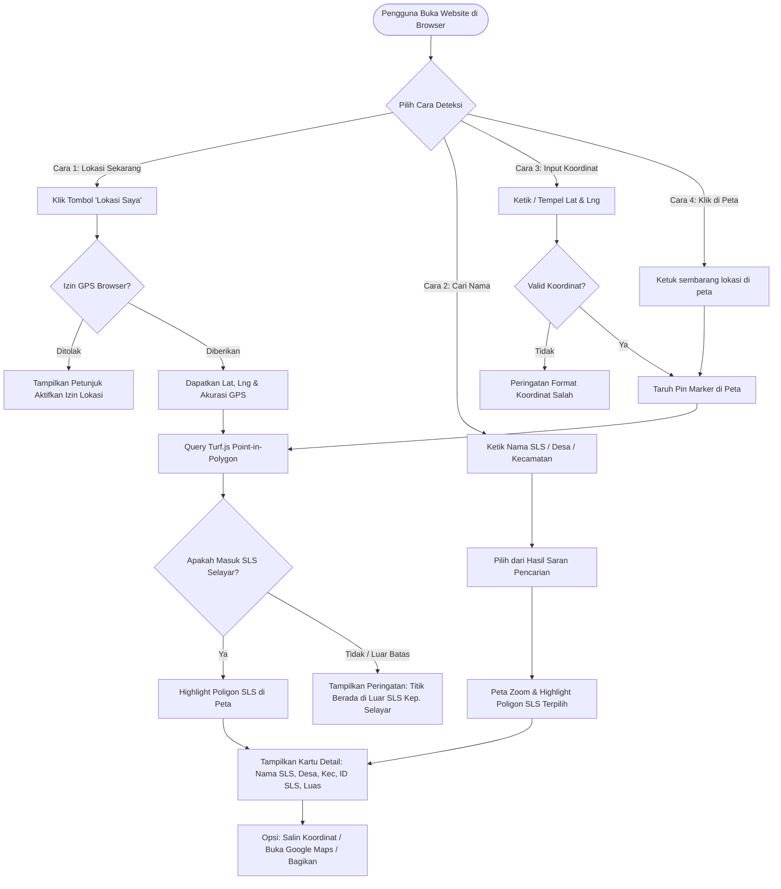

# Product Requirement Document (PRD)
## SLS Finder Kepulauan Selayar (WebGIS SLS Explorer)

| Dokumen | Product Requirement Document (PRD) |
| :--- | :--- |
| **Nama Produk** | **SLS Finder Kepulauan Selayar** (*Peta & Deteksi Lokasi Satuan Lingkungan Setempat*) |
| **Status** | Draft Ready for Implementation |
| **Target Rilis** | MVP (v1.0.0) |
| **Deployment Platform** | GitHub Pages (Static Web Hosting) |
| **Data Sumber** | `Final_SLS_202517301.geojson` (Wilkerstat BPS Semester 1 2025) |
| **Target Pengguna** | Petugas Lapangan BPS (Mitra/PCL/PML), Staf Teknis BPS, Pemda Kab. Kepulauan Selayar, dan Masyarakat Umum |

---

## 1. Latar Belakang & Permasalahan

### 1.1 Latar Belakang
Satuan Lingkungan Setempat (SLS) seperti RT, RW, Dusun, atau Lingkungan adalah unit geografis terkecil yang digunakan oleh Badan Pusat Statistik (BPS) dalam kegiatan sensus dan survei (misalnya Sensus Penduduk, Sensus Pertanian, Susenas, Sakernas, dan pemutakhiran kerangka geospasial).

Kabupaten Kepulauan Selayar terdiri dari 11 kecamatan yang tersebar di pulau utama maupun pulau-pulau terluar (seperti Pasilambena, Pasimarannu, Takabonerate). Petugas lapangan sering kali kesulitan menentukan secara pasti batas SLS di mana mereka berdiri saat sedang melakukan pendataan door-to-door.

### 1.2 Masalah yang Dihadapi (Problem Statement)
1. **Ketidakpastian Batas Lapangan**: Petugas di lapangan sering ragu apakah suatu rumah/responden masuk ke dalam RT/Dusun A atau RT/Dusun B, terutama di wilayah perbatasan tanpa tanda fisik yang jelas.
2. **Kebutuhan Verifikasi Koordinat**: Petugas pengawas (PML/Admin) sering menerima data koordinat GPS (misal dari form CAPI/FASIH) dan perlu memeriksa cepat apakah koordinat tersebut benar berada di dalam SLS target atau melenceng (*outlier*).
3. **Keterbatasan Aplikasi Berat**: Membuka software GIS desktop (seperti QGIS atau ArcGIS) membutuhkan laptop dan keahlian teknis khusus yang tidak dimiliki semua petugas lapangan di perangkat ponsel pintar.
4. **Kebutuhan Hosting Tanpa Biaya Server**: Dibutuhkan solusi webgis yang ringan, cepat, gratis, tanpa server backend (serverless), serta dapat di-deploy dengan mudah melalui **GitHub Pages**.

---

## 2. Tujuan & Sasaran Produk (Goals & Non-Goals)

### 2.1 Goals (Tujuan Utama)
- **Deteksi Otomatis Lokasi Pengguna (Live GPS)**: Menentukan SLS, Desa/Kelurahan, dan Kecamatan pengguna secara *real-time* saat berada di lapangan hanya dengan satu klik tombol.
- **Pencarian Cepat (Multi-level Search)**: Memungkinkan pengguna mencari SLS berdasarkan nama SLS (RT/RW/Dusun), nama Desa, atau nama Kecamatan, lalu otomatis mengarahkan peta ke poligon tersebut.
- **Pengecekan Koordinat Manual (Reverse Spatial Lookup)**: Pengguna dapat mengetikkan koordinat Latitude & Longitude atau mengklik sembarang titik di peta untuk mengetahui SLS yang mencakup titik tersebut.
- **100% Client-Side & Static**: Seluruh proses *point-in-polygon* dan *search* berjalan di browser (RAM perangkat), sehingga dapat di-deploy sepenuhnya di **GitHub Pages**.
- **Mobile-First & Responsive UX**: Tampilan ramah perangkat seluler (smartphone) dengan kontrol sentuh yang mulus.

### 2.2 Non-Goals (Bukan Tujuan MVP)
- Sistem login / otentikasi pengguna berbasis akun.
- Penyuntingan (editing/digitizing) geometri batas SLS secara langsung di web (data sifatnya *read-only*).
- Database relasional dinamis di sisi server (MySQL/PostgreSQL) — semua data spasial disediakan dalam bentuk file statis terkompresi.

---

## 3. Profil Pengguna (User Personas)

1. **Petugas Lapangan / Enumerator (PCL/Mitra BPS)**
   - *Karakteristik*: Berada langsung di lapangan, menggunakan smartphone Android/iOS, koneksi internet kadang tidak stabil.
   - *Kebutuhan*: Buka web -> klik "Lokasi Saya" -> muncul info "Anda berada di RT 01 Dusun Bunging, Desa Appatanah, Kec. Bontosikuyu".
2. **Pengawas Lapangan (PML) & Subject Matter Officer BPS**
   - *Karakteristik*: Menggunakan laptop/ponsel, memeriksa hasil pengawasan sampling survei.
   - *Kebutuhan*: Salin koordinat dari hasil survei -> tempel (paste) di web -> validasi apakah responden benar masuk SLS sampel.
3. **Pemerintah Desa & Masyarakat Umum**
   - *Karakteristik*: Mengetahui nama dusun/RT tetapi ingin melihat batas visual wilayah administrasinya di peta satelit.

---

## 4. Kebutuhan Fungsional (Functional Requirements)

### Modul 1: Deteksi Lokasi Sekarang (Live Geolocation)
- **FR-1.1**: Terdapat tombol "Deteksi Lokasi Saya" (Floating Action Button / tombol utama di bar navigasi).
- **FR-1.2**: Aplikasi meminta izin akses Geolocation browser (`navigator.geolocation.getCurrentPosition`) dengan opsi `enableHighAccuracy: true`.
- **FR-1.3**: Aplikasi menampilkan penanda (marker) posisi pengguna beserta lingkaran radius akurasi GPS (dalam satuan meter).
- **FR-1.4**: Aplikasi melakukan kalkulasi spasial *Point-in-Polygon* (PIP) terhadap layer batas SLS Selayar secara instan.
- **FR-1.5**: Jika titik berada di dalam poligon SLS:
  - Tampilkan kartu ringkasan info: **Nama SLS**, **Nama Desa/Kelurahan**, **Nama Kecamatan**, **ID SLS**, serta **Luas Wilayah**.
  - Berikan highlight visual pada poligon SLS yang bersangkutan (warna garis & arsiran aktif).
- **FR-1.6**: Jika titik berada di luar Kabupaten Kepulauan Selayar atau GPS belum mengunci:
  - Tampilkan pesan informatif: *"Lokasi Anda berada di luar wilayah Kabupaten Kepulauan Selayar"* atau *"Gagal mendapatkan sinyal GPS yang akurat"*.

### Modul 2: Pencarian SLS, Desa, dan Kecamatan (Unified Search)
- **FR-2.1**: Terdapat input pencarian (*Search Bar*) dengan fitur auto-complete / dropdown saran instan (*search-as-you-type*).
- **FR-2.2**: Pencarian mendukung kueri:
  - Nama SLS (contoh: `"Dusun Bunging"`, `"RT 02"`, `"BENTENG TIMUR"`)
  - Nama Desa / Kelurahan (contoh: `"Appatanah"`, `"Benteng"`, `"Bontomanai"`)
  - Nama Kecamatan (contoh: `"Bontosikuyu"`, `"Takabonerate"`, `"Pasilambena"`)
  - ID SLS (contoh: `"73010300030002"`)
- **FR-2.3**: Hasil pencarian dikelompokkan dengan jelas (Kecamatan, Desa, atau SLS).
- **FR-2.4**: Saat salah satu hasil pencarian dipilih:
  - Peta otomatis melakukan *Fly-To / FitBounds* ke wilayah yang dipilih.
  - Poligon target di-highlight.
  - Panel info membuka detail properti wilayah tersebut.

### Modul 3: Input & Cek Koordinat Manual
- **FR-3.1**: Terdapat menu/modal "Input Koordinat" dengan field:
  - Input Latitude (contoh: `-6.49178`)
  - Input Longitude (contoh: `120.48547`)
  - *Quick Input*: Satu kolom tunggal yang otomatis mengenali format copy-paste dari Google Maps (contoh: `-6.49178, 120.48547`).
- **FR-3.2**: Validasi input koordinat:
  - Memastikan angka numerik valid dalam rentang geografis yang masuk akal (Latitude: -90 s/d 90, Longitude: -180 s/d 180).
- **FR-3.3**: Tombol "Periksa Lokasi" untuk mengeksekusi lookup spasial.
- **FR-3.4**: Fitur Klik Peta Langsung (*Interactive Map Tap*):
  - Pengguna dapat mengklik sembarang titik di peta.
  - Titik tersebut akan memunculkan marker baru dan langsung menjalankan query deteksi SLS yang sama.

### Modul 4: Peta Interaktif & Visualisasi Spasial
- **FR-4.1**: Peta interaktif mendukung navigasi sentuh (pinch-to-zoom, pan, rotate).
- **FR-4.2**: Pemilih Peta Dasar (*Basemap Switcher*):
  - OpenStreetMap (Default - Peta Jalan)
  - Esri World Imagery (Citra Satelit resolusi tinggi - sangat berguna mengenali atap rumah di lapangan)
  - Carto Positron / Google Hybrid / OSM Humanitarian
- **FR-4.3**: Styling Layer SLS:
  - Garis batas tegas (misal oranye/biru kontras) dengan opasitas transparan agar citra satelit di bawahnya tetap terlihat.
  - Label nama SLS yang muncul dinamis saat zoom level memadai (>= level 14) agar peta tidak terlalu padat (*cluttered*).
- **FR-4.4**: Filter Hierarkis (Opsional / Nilai Tambah):
  - Dropdown bertingkat: Pilih Kecamatan -> Pilih Desa -> Pilih SLS untuk memfokuskan peta.
### Modul 5: Batch Upload Koordinat (Excel / CSV)
- **FR-5.1**: Fitur upload berkas `.xlsx`, `.xls`, dan `.csv` tanpa ketergantungan server (100% *client-side* via pustaka SheetJS).
- **FR-5.2**: Deteksi otomatis nama kolom koordinat (Latitude / Lintang / Y dan Longitude / Bujur / X) serta kolom nama responden/label, dengan dukungan konfigurasi manual jika format kolom kustom.
- **FR-5.3**: Algoritma verifikasi spasial massal *Point-in-Polygon* ke seluruh 721 poligon SLS Selayar secara instan (<100ms untuk ratusan titik).
- **FR-5.4**: Visualisasi sebaran titik di peta (*Canvas / CircleMarkers*) dengan pengkodean warna status:
  - Hijau: Titik di dalam SLS Kepulauan Selayar.
  - Merah: Titik di luar wilayah Selayar (*outlier*).
- **FR-5.5**: Pratinjau tabel interaktif dengan filter status dan tombol fokus/sorot SLS langsung di peta.
- **FR-5.6**: Ekspor hasil verifikasi kembali ke file Excel (`.xlsx`) dengan atribut tambahan: `STATUS_VERIFIKASI`, `ID_SLS_TERDETEKSI`, `NAMA_SLS_TERDETEKSI`, `DESA_TERDETEKSI`, dan `KECAMATAN_TERDETEKSI`.
- **FR-5.7**: Tombol unduh *template* Excel standar untuk memandu pengguna menyiapkan data.

---

## 5. Struktur Data & Pemetaan Atribut

Dataset yang digunakan adalah `Final_SLS_202517301.geojson` yang terdiri dari **721 poligon SLS** di Kabupaten Kepulauan Selayar dengan atribut utama sebagai berikut:

| Nama Field GeoJSON | Tipe Data | Label Antarmuka | Deskripsi & Contoh |
| :--- | :--- | :--- | :--- |
| `idsls` | String (14 digit) | **ID SLS** | Kode unik SLS nasional (contoh: `73010300030002`) |
| `nmsls` | String | **Nama SLS** | Nama satuan lingkungan (contoh: `RT 02 RK 02 DUSUN BUNGING`) |
| `kdsls` | String (4 digit) | **Kode SLS** | Nomor urut SLS dalam desa (contoh: `0002`) |
| `nmdesa` | String | **Desa / Kelurahan** | Nama Desa/Kelurahan (contoh: `APPATANAH`) |
| `kddesa` | String (3 digit) | **Kode Desa** | Kode kemendagri/BPS desa (contoh: `003`) |
| `nmkec` | String | **Kecamatan** | Nama Kecamatan (contoh: `BONTOSIKUYU`) |
| `kdkec` | String (3 digit) | **Kode Kecamatan** | Kode kecamatan (contoh: `030`) |
| `nmkab` | String | **Kabupaten** | `KEPULAUAN SELAYAR` |
| `nmprov` | String | **Provinsi** | `SULAWESI SELATAN` |
| `luas` | Number (Float) | **Estimasi Luas** | Luas wilayah dalam Km² atau Ha (contoh: `0.0739`) |
| `geometry` | MultiPolygon (WGS84) | Geometri Poligon | Koordinat `[Longitude, Latitude]` EPSG:4326 |

---

## 6. Kebutuhan Non-Fungsional (Non-Functional Requirements)

### 6.1 Performa & Optimasi File (Khusus GitHub Pages)
- **Ukuran File**: File GeoJSON mentah berukuran ~2.6 MB. Pada GitHub Pages dengan kompresi Gzip/Brotli, transfer data akan menjadi **~500 - 700 KB** saja, sangat ringan untuk diunduh sekali di awal sesi.
- **Spatial Indexing**: Penggunaan algoritma **R-Tree / Flatbush / RBush** di sisi JavaScript agar pengecekan *Point-in-Polygon* dari 721 poligon berlangsung kurang dari **10 milidetik (instant)**.
- **Lazy Loading / Memory**: Geometri diserialisasi secara efisien sehingga tidak menyebabkan browser ponsel mengalami *freeze*.

### 6.2 Kemampuan Offline & PWA (Progressive Web App)
- Mengingat wilayah Kepulauan Selayar memiliki titik-titik *blindspot* sinyal, aplikasi dirancang dengan dukungan **PWA** dan **Service Worker**:
  - Aset web (HTML, JS, CSS, GeoJSON) di-cache lokal.
  - Setelah dibuka sekali saat online, aplikasi tetap dapat dibuka saat offline untuk cek koordinat & GPS (GPS smartphone bekerja via satelit tanpa memerlukan paket data internet).

### 6.3 Responsivitas & Desain Antarmuka (Mobile-First)
- Layout dioptimalkan untuk layar ponsel pintar vertikal (portrait).
- Peta memenuhi 100% tinggi layar (*fullscreen*).
- Informasi SLS ditampilkan dalam bentuk *Bottom Sheet Drawer* yang dapat digeser (swipe up/down) agar tidak menutupi tampilan peta.

### 6.4 Keamanan & Privasi
- Aplikasi **tidak mengirim data koordinat pengguna ke server eksternal**.
- Semua komputasi spasial dilakukan 100% lokal di browser pengguna (*Client-Side Confidentiality*).
- Hosting di GitHub Pages dilengkapi enkripsi HTTPS resmi secara otomatis.

---

## 7. Arsitektur Teknis & Stack Rekomendasi

```
+-------------------------------------------------------------+
|                     Client Browser                          |
|  (Ponsel Android/iOS / Komputer Desktop)                     |
+-------------------------------------------------------------+
   |                                                      |
   | 1. Unduh bundle web statis                           | 2. Baca GPS & Input User
   v                                                      v
+-------------------------------+             +-----------------------+
|  GitHub Pages Static Hosting  |             | Browser Geolocation   |
|  - index.html                 |             | HTML5 API / Touch /   |
|  - app.bundle.js (Leaflet/UI) |             | Koordinat Manual      |
|  - app.css (Tailwind)         |             +-----------------------+
|  - Final_SLS_202517301.geojson|                         |
+-------------------------------+                         |
                                                          v
                                              +-----------------------+
                                              | Local Spatial Engine  |
                                              | - Turf.js (PIP Query) |
                                              | - Fuse.js (Search)    |
                                              +-----------------------+
                                                          |
                                                          v
                                              +-----------------------+
                                              | Tampilan Hasil & Peta |
                                              | - Leaflet Map View    |
                                              | - Bottom Sheet Info   |
                                              +-----------------------+
```

### 7.1 Teknologi yang Direkomendasikan
1. **Frontend Core**:
   - **Pilihan Praktis**: Single Page Application berbasis **Vite + Vanilla JS** atau **Vite + React / Preact + Tailwind CSS**.
   - Ringan, build artifact sangat kecil (<200KB bundle), dan siap deploy instan ke GitHub Pages.
2. **Peta & GIS Engine**:
   - **Leaflet.js**: Sangat stabil, ringan (~40KB), performa sentuh di smartphone sangat gegas.
   - **Turf.js (`@turf/boolean-point-in-polygon` & `@turf/bbox`)**: Menangani kalkulasi titik di dalam poligon secara akurat.
3. **Mesin Pencarian (Fuzzy Search)**:
   - **Fuse.js** atau **MiniSearch**: Indeks pencarian teks lokal berkecepatan tinggi dengan toleransi typo penulisan nama SLS/Desa.
4. **Desain Komponen UI**:
   - **Tailwind CSS**: Untuk UI modern, clean, dan mudah responsif di berbagai resolusi layar.
   - **Lucide Icons**: Ikon modern (GPS icon, Search icon, Map pin, Copy icon).
5. **CI/CD Deployment**:
   - **GitHub Actions** (`.github/workflows/deploy.yml`): Otomatis build dan deploy setiap kali ada push ke branch `main`.

---

## 8. Desain Alur Pengguna (User Flow)



---

## 9. Desain Antarmuka Pengguna (Wireframe & Layout)

### 9.1 Tampilan Mobile (Layar Smartphone)
```
+-------------------------------------------------+
| [🔍 Cari SLS / Desa / Kecamatan...       ] [⚙️]  | <-- Search Bar Melayang (Top Bar)
+-------------------------------------------------+
|                                                 |
|                 PETA INTERAKTIF                 |
|             (Leaflet + Citra Satelit)           |
|                                                 |
|           [ Poligon SLS Terpilih ]              |
|                     📍                          |
|                                                 |
|                                  [ 🛰️ Basemap ] | <-- Tombol Ganti Layer
|                                  [ 🎯 Lokasi  ] | <-- Tombol Floating GPS
+-------------------------------------------------+
|  ┌─ Pull Bar (Geser ke Atas untuk Detail) ────┐ |
|  │ 🏢 RT 02 RK 02 DUSUN BUNGING               │ | <-- Bottom Sheet Drawer
|  │ 📍 Desa Appatanah, Kec. Bontosikuyu        │ |
|  │ 🆔 ID SLS: 73010300030002 | Luas: 0.07 km² │ |
|  │ [📋 Salin Info] [🗺️ Buka Rute Google Maps] │ |
|  └────────────────────────────────────────────┘ |
+-------------------------------------------------+
```

### 9.2 Komponen Modal "Input Koordinat"
```
+-------------------------------------------------+
| 📍 Cek Titik Koordinat                          |
|                                                 |
| Format Cepat (Paste dari Maps):                 |
| [ -6.49178, 120.48547                         ] |
|                                                 |
| Atau Masukkan Terpisah:                         |
| Latitude  : [ -6.49178                        ] |
| Longitude : [ 120.48547                       ] |
|                                                 |
| [ Batalkan ]               [ 🔍 Periksa Posisi ]|
+-------------------------------------------------+
```

---

## 10. Rencana Rilis & Milestone Pengembangan

| Tahap | Aktivitas Utama | Output |
| :--- | :--- | :--- |
| **Fase 1: Setup & Data Prep** | - Inisialisasi repositori Git & build tools (Vite/Tailwind).<br>- Pengujian integrasi file `Final_SLS_202517301.geojson`.<br>- Setup workflow GitHub Actions untuk GitHub Pages. | Repositori aktif dengan pipeline CI/CD otomatis. |
| **Fase 2: Core Map & Geolocation** | - Tampilan peta Leaflet dengan basemap OSM & Satelit Esri.<br>- Integrasi tombol GPS browser & marker akurasi.<br>- Implementasi spatial PIP query (Turf.js). | Peta menampilkan lokasi GPS sekarang dan mendeteksi SLS terkait. |
| **Fase 3: Search & Coordinate Input** | - Mesin pencarian teks cepat (Fuse.js) untuk SLS, Desa, Kecamatan.<br>- Modal input koordinat manual & event klik di peta.<br>- Bottom Sheet drawer hasil analisis. | Fitur pencarian dan input koordinat berfungsi penuh. |
| **Fase 4: PWA Offline & Polishing UX** | - PWA Manifest & Service Worker untuk caching aset dan GeoJSON.<br>- Optimasi loading & styling tema UI yang profesional.<br>- Tombol copy info & integrasi Google Maps navigasi. | Web dapat diinstal di homescreen HP dan dapat diakses offline. |
| **Fase 5: Testing & Go-Live** | - Pengujian lapangan di berbagai wilayah Kecamatan Selayar.<br>- Verifikasi pada browser mobile (Chrome, Safari, Firefox).<br>- Publikasi resmi URL GitHub Pages. | Website live dan siap digunakan oleh petugas lapangan. |

---

## 11. Kriteria Penerimaan (Acceptance Criteria)

1. **Akurasi Deteksi GPS**:
   - Ketika pengguna berada di wilayah Kepulauan Selayar dan menekan "Lokasi Saya", sistem dalam waktu < 2 detik harus menampilkan nama SLS, Desa, dan Kecamatan yang sesuai dengan data poligon resmi.
2. **Kesesuaian Pencarian**:
   - Mengetik salah satu dari 11 nama kecamatan (contoh: *Bontomatene*, *Takabonerate*) langsung memunculkan daftar opsi yang relevan.
   - Mengetik nama SLS (contoh: *Bunging*) memunculkan SLS terkait dan saat diklik langsung memusatkan peta ke poligon tersebut.
3. **Validitas Input Koordinat**:
   - Memasukkan koordinat `-6.49178, 120.48547` secara tepat mengidentifikasi SLS `73010300030002` (RT 02 RK 02 DUSUN BUNGING, Desa APPATANAH, Kec. BONTOSIKUYU).
4. **Deployability di GitHub Pages**:
   - Proyek dapat dibuild secara statis (`dist/`) tanpa ketergantungan runtime backend dan berjalan mulus di domain `https://<username>.github.io/<repo-name>/`.
5. **Responsif & Ramah Seluler**:
   - Tidak ada elemen yang terpotong pada layar ponsel beresolusi standar (360x640 hingga 412x915).

---

## 12. Rekomendasi Langkah Selanjutnya (Next Steps)

1. **Review & Persetujuan PRD**: Memastikan lingkup fitur sudah sesuai dengan kebutuhan operasional di lapangan.
2. **Inisialisasi Project Starter**: Membuat struktur kode proyek (HTML/Vite + Leaflet) di folder kerja ini.
3. **Pengujian Script Prototype**: Memverifikasi pemuatan `Final_SLS_202517301.geojson` dan fungsi Turf.js di browser lokal sebelum di-push ke GitHub.
